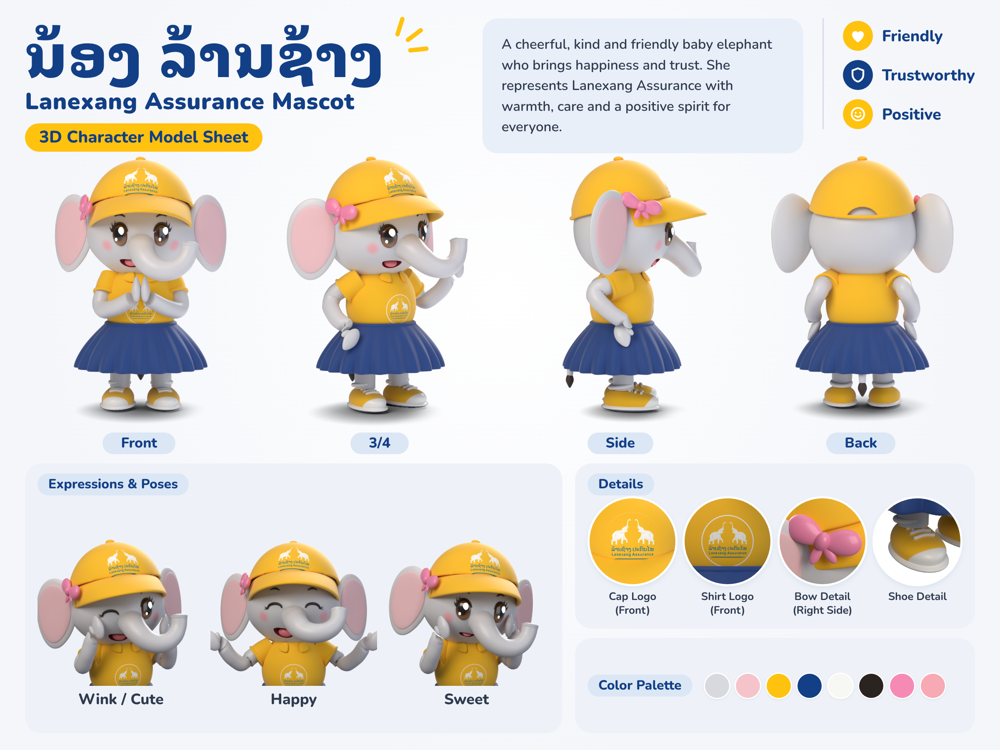

# Nong Lanxang (ນ້ອງ ລ້ານຊ້າງ) – 3D mascot

A rigged Blender model of the Lanexang Assurance baby-elephant mascot, built from
the 2D character model sheet. She's a grey elephant in the yellow logo cap with a
pink bow, a yellow polo with the shirt logo, a navy pleated skirt and yellow canvas
sneakers. She comes with ready-made poses and facial expressions.



| File | What it is |
| --- | --- |
| `nong_lanxang.blend` | The rigged model with poses, studio lights and camera. Textures are packed in. Saved with Blender 5.2. |
| `build_mascot.py` | Builds the model, rig, face controls, poses and studio with Blender's Python API. |
| `render_sheet.py` | Renders every picture on the sheet from the `.blend` as transparent PNGs. |
| `make_sheet.py` | Lays the renders out as `renders/model_sheet.png` (HTML, then a Chromium screenshot). |
| `make_decals.py` | Turns `brochure/assets/logo.png` into the cap and shirt decals in `textures/`. |
| `renders/` | The individual renders and the finished sheet. They have transparent backgrounds, so they can be dropped straight onto other designs. |
| `sheet/fonts/` | Noto Sans Lao Looped and Nunito (SIL OFL 1.1), embedded into the sheet. `make_sheet.py` also writes `sheet/model_sheet.html` and `sheet/img/` (not committed). |

## Rebuilding

With Blender installed:

```sh
blender --background --python build_mascot.py -- --out nong_lanxang.blend
blender --background nong_lanxang.blend --python render_sheet.py -- --out renders
python make_sheet.py            # needs Pillow, numpy and Chrome/Chromium
```

Or with the `bpy` module from PyPI (`pip install bpy pillow`, Python 3.13):

```sh
python build_mascot.py --out nong_lanxang.blend
python render_sheet.py --blend nong_lanxang.blend --out renders
python make_sheet.py
```

`render_sheet.py` options: `--shots front,wink`, `--samples 96`, `--scale 50` (resolution %, for quick tests).

## Using it with a Blender MCP server

`build_mascot.py` only uses `bpy`, so it can be sent to a live Blender session
through a Blender MCP server's "execute code" tool, or run from Blender's
**Scripting** tab. In a live session it doesn't reset the file. It only replaces
what an earlier run created (the `Nong_LanXang` and `Studio` collections and its
own `Pose_*` actions), so the MCP add-on and your other objects stay put. It saves
only when `--out` is given. Keep `textures/` next to the script, or pass
`--textures`; without the decals it still builds, just without the logos.

## Posing her

Select **Nong_LanXang_Rig** and enter Pose Mode.

| Bones | What they move |
| --- | --- |
| `root` | Everything (place / turn her) |
| `torso`, `head` | Body and head |
| `ear.L/R` | Ears |
| `trunk.1` → `trunk.3` | Trunk, bends smoothly |
| `upper_arm`, `forearm`, `hand` `.L/.R` | Arms, bend smoothly at the elbow |
| `leg.L/R`, `tail` | Legs with shoes, tail |
| `mouth` | Scale X (width) and Z (height) to open or close the smile |

**Eyes** are custom properties on the rig object (Object properties → Custom
Properties): set `eye_closed_L` or `eye_closed_R` to 1 to close that eye as a
smiling arc.

**Saved poses** are actions marked as pose assets, so they show in the Pose
Library. You can also assign one to the rig in the Action editor.

| Action | Pose |
| --- | --- |
| `Pose_Nop` | Hands pressed together in a nop (the rest pose) |
| `Pose_Wave` | Waving with her left hand |
| `Pose_Relaxed` | Arms resting at her sides |
| `Pose_Happy` | Arms spread, eyes closed, big smile |
| `Pose_Sweet` | Hands on her cheeks, small smile |
| `Pose_Wink` | Hands on her cheeks, winking |

The poses are defined as data in `POSES` in `build_mascot.py`. Arms are placed
by wrist position, elbow direction and palm direction, through a small two-bone IK
solve, so new poses are quick to add.

## Scene layout

- Collections: `Head` (head, ears, trunk), `Face` (eyes, lashes, brows,
  closed-eye arcs, tongue), `Cap` (crown, brim, button, strap, bow), `Body`
  (shirt, collar, sleeves, skirt, tail), `Limbs`, `Shoes`, and `Helpers`
  (hidden boolean cutters and the two logo projectors).
- The character is 2 units tall, stands on z = 0 and faces −Y.
- The floor is a shadow catcher and the film is transparent, so renders come out
  as cut-outs with a contact shadow.

## Editing notes

- **Shapes** are plain numbers in `build_mascot.py`. The trunk path is in
  `build_trunk`, the cap rim in `build_cap` (`rim_front` / `rim_back`), and the
  colours in `PALETTE`.
- **Logos** are projected by the `Cap_Logo_Projector` and
  `Shirt_Logo_Projector` empties. Move or scale them to reposition a logo.
- **Blush, cap seams, eye iris and the shoe toe cap** are procedural shader
  nodes. They render in Cycles/EEVEE, but exporting to glTF/FBX for a game
  engine or the web needs them baked to textures first.
- The mouth is a boolean cut (`Mouth_Cutter`, carried by the `mouth` bone), and
  so is the opening at the back of the cap.
